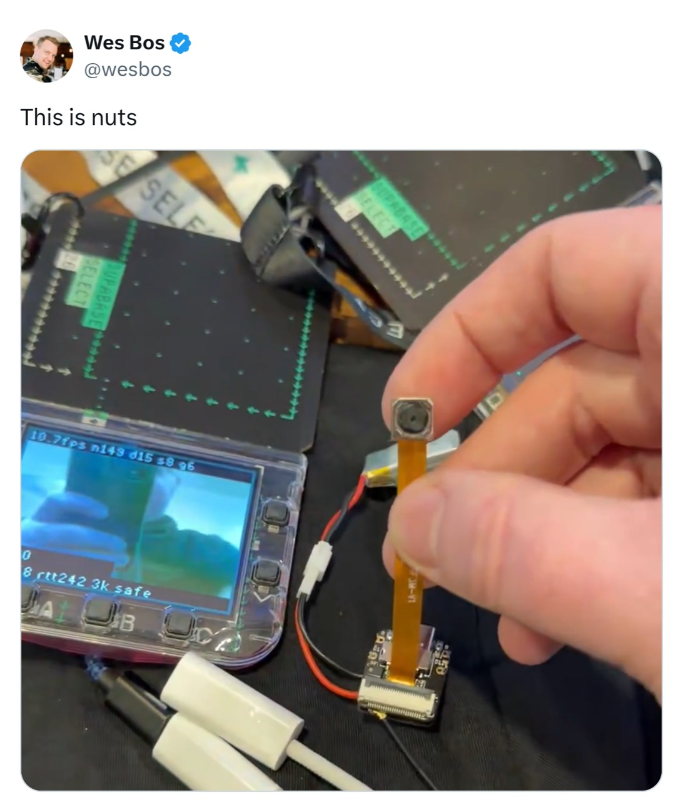

# ESP32 badge video streamer

Live video from a **Seeed XIAO ESP32-S3 Sense** to a **Pimoroni Tufty 2350**.
The ESP32 creates its own Wi-Fi hotspot; the badge joins and displays the
camera feed. No router or Internet connection is needed.

<a href="https://x.com/wesbos/status/2111109101174624669"></a>

**B** toggles the FPS/statistics HUD. This project sends video only, with no
motor controls or control channel. For driving a robot, use
[ESP32 badge RC](https://github.com/meech-ward/esp32-badge-rc).

## Choose the badge receiver

| Receiver | Firmware | Default video |
| --- | --- | --- |
| [Badgeware app](tufty/video_streamer/) | Keeps stock Badgeware v3.0.2 | 160×120, JPEG q6 |
| [Native C++ receiver](native/README.md) | Replaces Badgeware while installed | 320×240, JPEG q6 |

Both reconnect automatically and use the same camera firmware and protocol.
The native option uses two cores, optimized JPEG decoding and overlapped frame
reception for the performance pipeline developed in the RC project. HOME exits
the stock app; on native firmware it enters USB BOOTSEL.

## Setup

You need a XIAO ESP32-S3 Sense with antenna, 8 MB flash, 8 MB octal PSRAM and
an OV2640 or OV5640 camera; a Tufty 2350; and power for both devices.
Install Python 3.10+, [uv](https://docs.astral.sh/uv/) for host tools/tests, and
[ESP-IDF v5.5.1](https://docs.espressif.com/projects/esp-idf/en/v5.5.1/esp32s3/get-started/index.html).

From the repository root, generate matching private Wi-Fi settings:

```sh
python3 tools/make_secrets.py
```

The hotspot is `tufty-video`. Its random password is written to ignored camera,
Badgeware and native configuration files. To regenerate all three, use `--force`,
then rebuild/update both boards. Existing users adding native firmware can copy
`native/secrets.example.h` to `native/secrets.h` and match their camera settings.

Activate ESP-IDF, then build and flash **the camera** using its serial port:

```sh
idf.py -C esp build
idf.py -C esp -p <camera-port> flash
```

For **stock Badgeware v3.0.2**, enter Disk Mode by double-tapping RESET, copy
`tufty/video_streamer/` into the volume's `apps/` directory, eject and open
**video_streamer**. Keep `apps/menu` for startup. The example Wi-Fi file can be
omitted. The optional [macOS installer](docs/development.md#badgeware-installation)
can install just this app or remove other apps with backups.

For **native firmware**, follow the [native build/install guide](native/README.md).
Builds need Pico SDK 2.2.0, a Cortex-M33 toolchain and the pinned JPEGDEC sources.
Update the camera before installing these viewers: the new HELLO frame-size
limit is accepted by current firmware, while the earlier camera expected zero.

## Watch on a Mac

Turn off badge streaming, join `tufty-video` Wi-Fi, and run from this folder:

```sh
uv run python -m host.relay --size qvga --quality 6 --credits 1
```

Open [the viewer](http://127.0.0.1:8090/). Stop with Ctrl-C before using the
badge again. The ESP accepts **one direct video receiver** at a time; a new
connection replaces the old one. Several browser windows can share the Mac
relay's single connection. USB is not needed to watch.

## How it streams

The camera keeps three capture buffers and one latest completed frame. A
receiver grants frame credits; the ESP sends the newest JPEG and skips stale
captures instead of building a playback queue. Camera waits, socket work and
retries are bounded. Software white balance settles to a slower sampling rate.

Stock Badgeware uses preallocated receive buffers, cached HUD graphics and
infrequent planned garbage collection. Native firmware overlaps receiving,
JPEG decoding and display DMA with two guarded compressed inputs. Production
builds omit detailed diagnostics and retain the HUD. Displayed FPS and partial
frame-age statistics do not measure complete camera-to-screen latency.
See the [wire protocol](docs/protocol.md) for details.

## Development

```sh
uv sync
uv run pytest -q
make -C esp/host_test
```

Builds and host tests cover the port; the newly adapted video-only firmware
still needs physical streaming qualification. RC hardware measurements are
source provenance, not a measured frame rate for this variant. See
[development notes](docs/development.md) for dependency setup, optional graphics
checks and verification limits.

[MIT licensed](LICENSE). Linked dependencies retain their own notices; see
[native/THIRD_PARTY.md](native/THIRD_PARTY.md).
